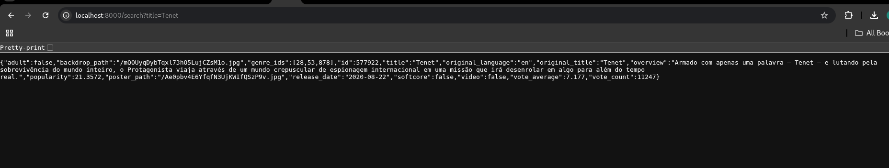
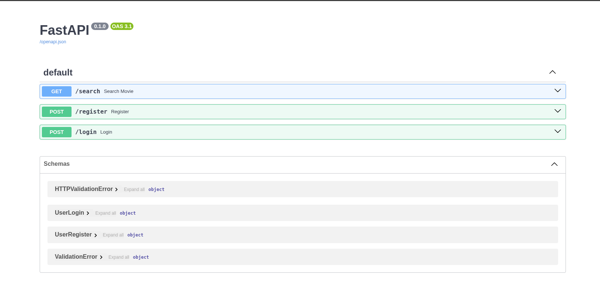

# Execution:

## add .env file
```
POSTGRES_USER=bruno
POSTGRES_PASSWORD=1234
POSTGRES_DB=transcendence
DATABASE_URL=postgresql://bruno:1234@db:5432/transcendence
TMDB_API_KEY=1f80937de1f4ff93588373b36e7b6dde
SECRET_KEY=d00d78f8dafde68448d096ca5c388c1adcfb66c1d4664ab92ead27140dccd924
```

```docker compose up --build```

```docker compose up -d``` runs in the background

```docker compose down```  The PostgreSQL container is removed

```docker compose down -v```  The PostgreSQL volume is also removed

and then in another terminal:

```docker exec -it transcendence_db psql -U bruno -d transcendence```

You can add an film going through this localhost:
https://localhost:8000/search?title=Tenet


You can see all routes in this link: https://localhost:8000/docs#/

## Commands to test:

```\dt```  database

```\l```  list of databases

```SELECT * FROM users;```

```SELECT * FROM reviews;```

```SELECT * FROM media;```

```DELETE FROM media;```  it will delete all of the films

## Backend structure

The FastAPI backend is organized by responsibility:

```text
backend/
├── main.py              # Application factory and router registration
├── routers/             # HTTP endpoints grouped by feature
│   ├── auth.py
│   ├── media.py
│   ├── reviews.py
│   └── users.py
├── schemas.py           # Request payload validation
├── services/tmdb.py     # TMDB integration
├── models.py            # SQLAlchemy models
├── database.py          # Engine and database session
└── auth.py              # Authentication dependency
```

Each router keeps HTTP concerns close to its endpoints, while TMDB calls and
request schemas are kept outside `main.py`. The application still starts with
the existing command:

```bash
uvicorn main:app --host 0.0.0.0 --port 8000 --reload \
  --ssl-keyfile ../certs/localhost.key \
  --ssl-certfile ../certs/localhost.crt
```

## Recommendations module
The recommendations module provides personalized film suggestions based on the genres of films the authenticated user has rated highly. The API endpoint is GET ```/users/me/recommendations.```

The recommendation logic:
1. Reads the authenticated user's reviews with a rating of 8/10 or higher.
2. Counts the genres present in those highly rated films to identify the user's preferred genres.
3. Searches the local media catalog for films in those genres that the user has not reviewed yet.
4. Ranks candidates by how strongly they match the user's preferred genres and returns up to 10 results.
5. Includes matched genres and a short explanation with each recommendation so the user can understand why it was suggested.
The endpoint requires authentication and only uses the current user's reviews to build their preferences. If the user has no highly rated reviews, it returns an empty recommendation list with an explanatory message.

This module was selected because it adds a personalized discovery feature to the platform using existing review and media data, without requiring a separate recommendation service or machine-learning infrastructure. It is a small, explainable recommendation system that can be extended in the future.
