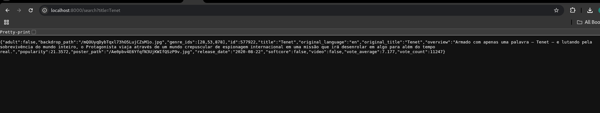
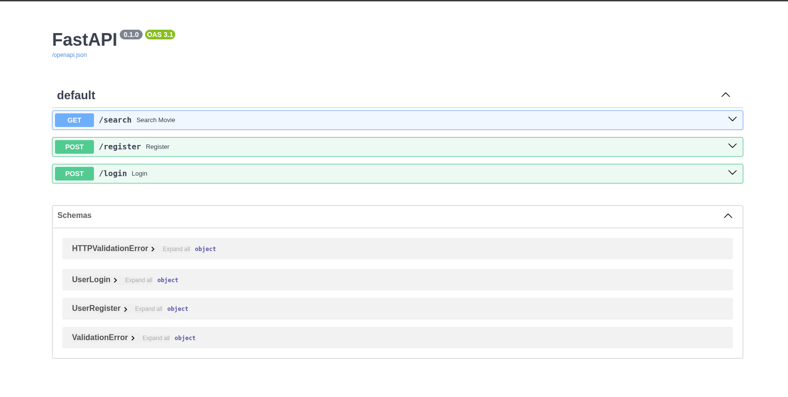

# Execution:

## add .env file
```
POSTGRES_USER=bruno
POSTGRES_PASSWORD=1234
POSTGRES_DB=transcendence
DATABASE_URL=postgresql://bruno:1234@db:5432/transcendence
TMDB_API_KEY=1f80937de1f4ff93588373b36e7b6dde
SECRET_KEY=d00d78f8dafde68448d096ca5c388c1adcfb66c1d4664ab92ead27140dccd924
PUBLIC_API_KEY=bae3ff4137350ef6e3a3414a0b77f535587a3e2c5ab5bc39ad969e3421f27b4b
```

```docker compose up --build```

```docker compose up -d``` runs in the background

```docker compose down```  The PostgreSQL container is removed

```docker compose down -v```  The PostgreSQL volume is also removed

and then in another terminal:

```docker exec -it transcendence_db psql -U bruno -d transcendence```

You can add an film going through this localhost:
https://localhost:8000/search?title=Tenet


You can see all routes in this link: https://localhost:8000/docs#/

## Commands to test:

```\dt```  database

```\l```  list of databases

```SELECT * FROM users;```

```SELECT * FROM reviews;```

```SELECT * FROM media;```

```DELETE FROM media;```  it will delete all of the films

## Backend structure

The FastAPI backend is organized by responsibility:

```text
backend/
├── main.py              # Application factory and router registration
├── routers/             # HTTP endpoints grouped by feature
│   ├── auth.py
│   ├── media.py
│   ├── reviews.py
│   └── users.py
├── schemas.py           # Request payload validation
├── services/tmdb.py     # TMDB integration
├── models.py            # SQLAlchemy models
├── database.py          # Engine and database session
└── auth.py              # Authentication dependency
```

Each router keeps HTTP concerns close to its endpoints, while TMDB calls and
request schemas are kept outside `main.py`. The application still starts with
the existing command:

```bash
uvicorn main:app --host 0.0.0.0 --port 8000 --reload \
  --ssl-keyfile ../certs/localhost.key \
  --ssl-certfile ../certs/localhost.crt
```

## Recommendations module
The recommendations module provides personalized film suggestions based on the genres of films the authenticated user has rated highly. The API endpoint is GET ```/users/me/recommendations.```

The recommendation logic:
1. Reads the authenticated user's reviews with a rating of 8/10 or higher.
2. Counts the genres present in those highly rated films to identify the user's preferred genres.
3. Searches the local media catalog for films in those genres that the user has not reviewed yet.
4. Ranks candidates by how strongly they match the user's preferred genres and returns up to 10 results.
5. Includes matched genres and a short explanation with each recommendation so the user can understand why it was suggested.
The endpoint requires authentication and only uses the current user's reviews to build their preferences. If the user has no highly rated reviews, it returns an empty recommendation list with an explanatory message.

This module was selected because it adds a personalized discovery feature to the platform using existing review and media data, without requiring a separate recommendation service or machine-learning infrastructure. It is a small, explainable recommendation system that can be extended in the future.

---

 
# Transcendence

Plataforma social de descoberta, avaliação e compartilhamento de experiências com filmes e outras mídias.

O **Transcendence** é um projeto desenvolvido em equipe com o objetivo de criar uma plataforma onde usuários podem descobrir filmes, publicar avaliações, interagir com outros usuários, acompanhar atividades de amigos e visualizar estatísticas relacionadas às suas experiências.

A aplicação combina uma interface moderna com uma API REST, autenticação, gerenciamento de usuários, funcionalidades sociais e ferramentas de análise de dados.

---

## Índice

- [Sobre o projeto](#sobre-o-projeto)
- [Principais funcionalidades](#principais-funcionalidades)
- [Tecnologias utilizadas](#tecnologias-utilizadas)
- [Arquitetura](#arquitetura)
- [Funcionalidades em detalhes](#funcionalidades-em-detalhes)
- [Banco de dados](#banco-de-dados)
- [API e documentação](#api-e-documentação)
- [Internacionalização](#internacionalização)
- [Segurança](#segurança)
- [Executando o projeto](#executando-o-projeto)
- [Estrutura do projeto](#estrutura-do-projeto)
- [Equipe e responsabilidades](#equipe-e-responsabilidades)
- [Status dos módulos](#status-dos-módulos)

---

## Sobre o projeto

O Transcendence propõe uma experiência que vai além de uma simples plataforma de consulta de filmes.

Os usuários podem criar uma conta, personalizar seus perfis, descobrir conteúdos, registrar suas avaliações, adicionar favoritos, construir conexões com outros usuários e acompanhar suas atividades.

A plataforma também oferece um dashboard de analytics, recomendações personalizadas e uma API pública documentada.

O projeto foi desenvolvido utilizando uma arquitetura cliente-servidor, com frontend em Next.js e backend em FastAPI, utilizando PostgreSQL para persistência dos dados.

## Principais funcionalidades

- Cadastro e autenticação de usuários.
- Autenticação baseada em JWT.
- Busca e descoberta de filmes.
- Consulta de detalhes das mídias.
- Criação, edição e exclusão de avaliações.
- Avaliações com notas por categorias.
- Curtidas em avaliações.
- Sistema de amigos.
- Sistema de seguidores e pessoas seguidas.
- Feed de atividades dos usuários seguidos.
- Perfis públicos e privados conforme as funcionalidades implementadas.
- Upload e personalização de avatar.
- Indicador de usuários online.
- Sistema de favoritos.
- Estatísticas individuais dos usuários.
- Dashboard de analytics.
- Exportação de dados em CSV e PDF.
- Recomendações personalizadas.
- API pública com documentação, autenticação por API key e rate limiting.
- Interface multilíngue em português, inglês e espanhol.
- Páginas de Privacy Policy e Terms of Service.

---

## Tecnologias utilizadas

### Frontend

| Tecnologia | Utilização |
|---|---|
| Next.js | Framework React e estrutura da aplicação |
| React | Construção de interfaces |
| TypeScript | Tipagem estática |
| Tailwind CSS | Estilização e layout responsivo |
| Axios | Comunicação com a API |
| Zod | Validação de dados |
| next-intl | Internacionalização |
| React Hook Form | Gerenciamento de formulários |

### Backend

| Tecnologia | Utilização |
|---|---|
| Python | Linguagem principal |
| FastAPI | Framework para construção da API REST |
| SQLAlchemy | ORM e comunicação com o banco |
| PostgreSQL | Banco de dados relacional |
| Alembic | Controle de migrations |
| JWT | Autenticação e autorização |
| bcrypt | Hash de senhas |

### Infraestrutura e ferramentas

- Docker e Docker Compose.
- HTTPS.
- Certificados locais para desenvolvimento.
- Git e GitHub.
- TMDB API para busca e informações de filmes.
- IGDB API prevista para expansão do suporte a jogos.

---

## Arquitetura

O projeto utiliza uma arquitetura separada em frontend, backend e banco de dados.

```text
                 ┌──────────────────────┐
                 │       Usuário        │
                 └──────────┬───────────┘
                            │
                            ▼
                 ┌──────────────────────┐
                 │      Frontend        │
                 │      Next.js         │
                 │      TypeScript      │
                 │      Tailwind CSS    │
                 └──────────┬───────────┘
                            │
                         HTTP/HTTPS
                            │
                            ▼
                 ┌──────────────────────┐
                 │       Backend        │
                 │       FastAPI        │
                 │      SQLAlchemy      │
                 │         JWT          │
                 └──────────┬───────────┘
                            │
                            ▼
                 ┌──────────────────────┐
                 │      PostgreSQL      │
                 │       Database       │
                 └──────────────────────┘
```

### Frontend

Responsável pela interface e interação com os usuários.

O Next.js organiza as páginas e componentes, enquanto o Axios realiza as requisições HTTP para o backend.

As informações são apresentadas por meio de componentes reutilizáveis, formulários, modais, cards, gráficos e seções de perfil.

### Backend

Responsável pelas regras de negócio, autenticação, validação, persistência e disponibilização dos dados.

O FastAPI fornece os endpoints REST, enquanto o SQLAlchemy realiza o mapeamento entre os modelos Python e as tabelas do PostgreSQL.

### Banco de dados

O PostgreSQL armazena informações dos usuários, mídias, avaliações, relacionamentos sociais, favoritos e demais dados da aplicação.

As alterações estruturais são controladas pelo Alembic.

### Docker

O Docker Compose organiza a execução dos serviços, permitindo iniciar frontend, backend e banco de dados por meio de um único comando.

---

## Funcionalidades em detalhes

### 1. Autenticação e gerenciamento de usuários

O sistema oferece cadastro e login de usuários.

Após autenticação, o backend gera um token JWT, utilizado para identificar o usuário nas requisições protegidas.

Funcionalidades:

- Cadastro com senha protegida por bcrypt.
- Login e geração de JWT.
- Middleware de autenticação.
- Proteção de endpoints privados.
- Consulta de perfil público.
- Edição de informações do perfil.
- Upload de avatar.
- Avatar padrão quando não existe imagem cadastrada.
- Indicador de status online.

### 2. Busca e descoberta de mídias

A plataforma utiliza a API do TMDB para buscar filmes e obter informações sobre as mídias.

Funcionalidades:

- Busca por título.
- Consulta de detalhes.
- Armazenamento local dos resultados.
- Prevenção de registros duplicados.
- Consulta de gêneros.
- Exibição de capas, descrições e informações de lançamento.

A integração com IGDB está prevista para ampliar a plataforma com suporte a jogos.

### 3. Reviews e avaliações

Os usuários autenticados podem registrar suas experiências com as mídias.

Cada avaliação permite atribuir uma nota geral e notas específicas por categoria:

- Atuação.
- Direção.
- Fotografia.
- Roteiro.
- Trilha sonora.

Também é possível adicionar um comentário, informar a data em que assistiu ao filme e indicar se já havia assistido anteriormente.

Funcionalidades:

- Criar avaliações.
- Consultar avaliações.
- Editar avaliações próprias.
- Excluir avaliações próprias.
- Curtir avaliações.
- Calcular médias das notas por categoria.

### 4. Sistema social

O Transcendence possui funcionalidades para conectar usuários e permitir interações dentro da plataforma.

Funcionalidades:

- Adicionar e remover amigos.
- Consultar lista de amigos.
- Seguir outros usuários.
- Deixar de seguir usuários.
- Consultar seguidores.
- Consultar quem está sendo seguido.
- Visualizar status online.
- Consultar atividades recentes de usuários seguidos.

### 5. Feed de atividades

O feed apresenta avaliações publicadas por usuários que o usuário autenticado segue.

As atividades são organizadas pela data de publicação, exibindo informações como:

- Usuário responsável pela avaliação.
- Avatar.
- Mídia avaliada.
- Nota atribuída.
- Comentário.
- Informações da mídia.
- Quantidade de curtidas.
- Data da publicação.

### 6. Perfil do usuário

Cada usuário possui uma página de perfil com informações e atividades relacionadas à sua conta.

O perfil reúne:

- Informações pessoais.
- Avatar e biografia.
- Estatísticas individuais.
- Lista de favoritos.
- Lista de amigos.
- Avaliações publicadas.
- Atividades recentes.

### 7. Analytics Dashboard

A plataforma possui um dashboard para visualização e análise de dados.

O dashboard apresenta informações sobre filmes, usuários e avaliações.

Entre os recursos implementados estão:

- Gráficos de filmes mais avaliados.
- Média de avaliações por gênero.
- Estatísticas individuais.
- Gênero favorito.
- Média geral das notas.
- Evolução mensal das avaliações.
- Filtros por período.
- Filtros por categoria.
- Exportação de dados em CSV e PDF.

### 8. Sistema de recomendações

O sistema de recomendações utiliza o histórico de avaliações do usuário para identificar categorias com notas altas.

Com base nessas informações, a aplicação recomenda filmes relacionados aos gêneros de maior interesse do usuário.

A funcionalidade está disponível por meio do endpoint:

`GET /users/me/recommendations`

O objetivo é oferecer sugestões personalizadas utilizando os próprios dados de interação da plataforma.

### 9. API pública

O backend disponibiliza uma API pública com documentação automática.

Recursos implementados:

- Documentação via Swagger.
- Autenticação por API key.
- Rate limiting nas rotas públicas.
- Endpoints com operações GET, POST, PUT e DELETE.

A documentação pode ser acessada pelo Swagger UI no endpoint `/docs`.

### 10. Internacionalização

A interface suporta três idiomas:

- Português (PT).
- Inglês (EN).
- Espanhol (ES).

A internacionalização é implementada utilizando `next-intl`.

O usuário pode alterar o idioma pela interface através do seletor de idiomas.

### 11. Privacidade e termos de uso

A aplicação disponibiliza páginas específicas para:

- Privacy Policy.
- Terms of Service.

Essas páginas podem ser acessadas pela interface da aplicação.

---

## Banco de dados

O PostgreSQL é utilizado como banco de dados principal.

O SQLAlchemy realiza o mapeamento objeto-relacional, permitindo que o backend manipule os dados por meio de modelos Python.

O Alembic é responsável por controlar as migrations e manter a evolução do schema do banco.

Entre as principais entidades do projeto estão:

| Entidade | Responsabilidade |
|---|---|
| Users | Informações dos usuários |
| Media | Filmes e outras mídias |
| Reviews | Avaliações publicadas |
| Review Likes | Curtidas em avaliações |
| Favorites | Mídias favoritas |
| Friendships | Relacionamentos de amizade |
| Follows | Relacionamentos de seguidores |

As migrations devem ser executadas para manter a estrutura do banco sincronizada com os modelos da aplicação.

---

## API e documentação

O backend utiliza FastAPI para disponibilizar os endpoints da aplicação.

A documentação automática é gerada pelo próprio framework.

Com o backend em execução, acesse:

- Swagger UI: `https://localhost:8000/docs` (ou a URL/porta configurada no ambiente).
- ReDoc: `https://localhost:8000/redoc` (ou a URL/porta configurada no ambiente).

A API possui endpoints para autenticação, usuários, mídias, avaliações, relacionamentos sociais, analytics e recomendações.

As rotas protegidas exigem autenticação por JWT, enquanto os endpoints públicos seguem as regras de API key e rate limiting implementadas.

---

## Internacionalização

A aplicação utiliza o `next-intl` para gerenciar os idiomas.

Os arquivos de tradução ficam organizados por idioma:

```text
public/
└── messages/
    ├── pt.json
    ├── en.json
    └── es.json
```

A configuração de rotas utiliza os locales:

```ts
locales: ['pt', 'en', 'es']
```

O português é o idioma padrão da aplicação.

---

## Segurança

A aplicação possui mecanismos de segurança implementados em diferentes camadas.

- Senhas armazenadas utilizando bcrypt.
- Autenticação por JWT.
- Proteção de endpoints privados.
- Validação de dados no frontend e backend.
- HTTPS no backend.
- API key para acesso externo à API pública.
- Rate limiting nas rotas públicas.
- Controle de acesso para operações sobre avaliações próprias.

---

## Executando o projeto

### Pré-requisitos

Para executar a aplicação, é necessário ter:

- Docker.
- Docker Compose.
- Git.

### 1. Clonar o repositório

```bash
git clone <URL_DO_REPOSITORIO>
```

Entre na pasta do projeto:

```bash
cd 42_transcendence
```

### 2. Configurar variáveis de ambiente

Configure as variáveis de ambiente necessárias para frontend e backend.

Utilize os arquivos de configuração do projeto como referência.

As credenciais e chaves de serviços externos, como TMDB e API key, devem ser configuradas no ambiente e não devem ser versionadas no Git.

### 3. Iniciar os containers

Execute:

```bash
docker compose up --build
```

O Docker Compose inicia os serviços configurados, incluindo:

- PostgreSQL.
- Backend FastAPI.
- Frontend Next.js.

### 4. Executar migrations

Caso seja necessário inicializar ou atualizar o schema do banco:

```bash
docker compose exec backend alembic upgrade head
```

### 5. Acessar a aplicação

Utilize os endereços e portas definidos no `docker-compose.yml`.

O Swagger do backend fica disponível em `/docs`.

---

## Estrutura do projeto

A estrutura geral da aplicação é organizada em frontend e backend.

```text
42_transcendence/
│
├── backend/
│   ├── alembic/
│   │   └── versions/
│   ├── routers/
│   ├── models.py
│   ├── database.py
│   ├── auth.py
│   ├── main.py
│   └── requirements.txt
│
├── frontend/
│   ├── public/
│   │   └── messages/
│   │       ├── pt.json
│   │       ├── en.json
│   │       └── es.json
│   ├── src/
│   │   ├── app/
│   │   ├── components/
│   │   ├── services/
│   │   ├── hooks/
│   │   ├── lib/
│   │   └── i18n/
│   ├── package.json
│   └── next.config.js
│
├── docker-compose.yml
├── TODO.md
└── README.md
```

*Observação: a estrutura acima representa a organização geral. Os diretórios e arquivos específicos podem variar conforme a versão atual do repositório.*

---

## Equipe e responsabilidades

O projeto foi desenvolvido colaborativamente, com responsabilidades divididas por módulos.

| Integrante | Responsabilidades |
|---|---|
| André | Infraestrutura, usuários e perfil, analytics, recomendações, internacionalização e frontend |
| Bruno | Autenticação, gerenciamento de mídias e integração com serviços externos |
| Luiz | Reviews, avaliações, notas por categoria e funcionalidades sociais |
| Elena | API pública, documentação, API key e rate limiting |
| Gabriel | Notificações e funcionalidades relacionadas à conformidade GDPR |

---

## Status dos módulos

O projeto foi desenvolvido com base nos módulos escolhidos e nos requisitos obrigatórios do subject.

### Funcionalidades implementadas

- Framework frontend e backend: Next.js e FastAPI.
- ORM com SQLAlchemy.
- Gerenciamento de usuários e perfis.
- Sistema de avaliações.
- Sistema social.
- API pública documentada.
- API key e rate limiting.
- Dashboard de analytics.
- Sistema de recomendações.
- Internacionalização PT, EN e ES.
- HTTPS no backend.
- Privacy Policy e Terms of Service.
- Feed de atividades.
- Exportação CSV/PDF.
- Docker Compose.

### Funcionalidades ainda pendentes conforme o TODO

- OAuth 2.0 com Google ou GitHub.
- Integração com IGDB para jogos.
- Sistema de notificações de seguidores e curtidas.
- Marcação de notificações como lidas.
- Exportação completa dos dados pessoais do usuário para GDPR.
- Exclusão de conta e respectivos dados.
- Confirmação por e-mail para operações de dados.
- Revisão final de responsividade e acessibilidade.
- Atualização do `.env.example`.
- Validação final de execução do ambiente do zero.

---

## Considerações finais

O Transcendence foi desenvolvido como uma aplicação full-stack colaborativa, integrando tecnologias modernas de frontend, backend e infraestrutura.

Além da implementação das funcionalidades principais, o projeto aborda conceitos importantes de desenvolvimento de software, como autenticação, autorização, modelagem relacional, integração com APIs externas, internacionalização, segurança, análise de dados e desenvolvimento de interfaces responsivas.

O resultado é uma plataforma social de avaliação e descoberta de mídias, construída para permitir a interação entre usuários e o acompanhamento de suas experiências dentro da aplicação.
